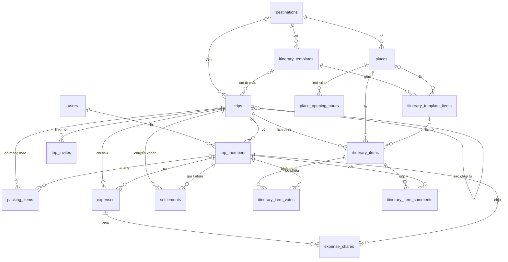

# Thiết kế database

Phạm vi là **MVP (Release 1)** trong Story map & backlog Sprint 1 của tuần Discovery (14/11/2026): người "gánh team" tạo chuyến, mời nhóm, dựng lịch trình (từ lịch trình mẫu hoặc sao chép chuyến khác), cả nhóm bình chọn, ước ngân sách, ghi chi tiêu và chia tiền.

**Không có trong schema này** vì đã tạm dừng hoặc cắt khỏi MVP: đặt khách sạn / tour, đánh giá xác thực, cộng đồng, thông báo. TravelGo **không tích hợp AI**: không có bảng hay cột nào cho lịch trình do AI soạn hoặc gợi ý bằng AI. Gợi ý trong app dùng quy tắc cố định (khoảng cách, giờ mở cửa, ngân sách), nên dữ liệu đầu vào là toạ độ, giờ mở cửa, giá và thời lượng của từng điểm.

## Quy ước

| | |
|---|---|
| CSDL | PostgreSQL ≥ 13 (docker compose dùng 17) |
| Tên | `snake_case` cho bảng và cột (`SnakeNamingStrategy`), thuộc tính TypeScript giữ `camelCase` |
| Khoá chính | `uuid`, mặc định `gen_random_uuid()` |
| Thời gian | `timestamptz` (UTC); ngày không có giờ dùng `date` |
| Tiền | `bigint` theo **đồng** (VND không có số lẻ). `pg` trả `bigint` về chuỗi; `moneyTransformer` đổi sang `number` |
| Liệt kê | enum của Postgres (`trip_status`, `expense_category`…) |
| Đổi schema | chỉ qua migration (`synchronize: false`) |

## Sơ đồ

`holiday_periods` đứng riêng, không có khoá ngoại: chuyến nào có ngày đi trùng khoảng lễ thì hiện cảnh báo.

## Các bảng

### Người dùng và địa điểm

| Bảng | Dùng để | Ghi chú |
|---|---|---|
| `users` | Tài khoản đăng nhập | Demo đăng nhập bằng OTP nên `phone` (E.164) là định danh chính; `email` để dành. Phải có ít nhất một trong hai. Bảng OTP / phiên đăng nhập thuộc PR auth |
| `destinations` | Điểm đến (Đà Lạt, Hội An…) | `region` = north / central / south, giống bộ lọc theo miền trong demo |
| `places` | Điểm có thể thêm vào lịch trình: tham quan, quán ăn, cà phê, chỗ ở | Toạ độ, `price_min`/`price_max` (đồng/người), `typical_duration_minutes` là đầu vào cho gợi ý theo quy tắc. `data_verified_at`: lần cuối team kiểm tra lại dữ liệu (giả định a10) |
| `place_opening_hours` | Giờ mở cửa theo thứ trong tuần | Bảng riêng để truy vấn được "điểm này có mở lúc 14:00 thứ Bảy không". Một ngày có thể nhiều khung giờ; `closes_at <= opens_at` là qua nửa đêm |
| `holiday_periods` | Dịp lễ theo từng năm và mức tăng giá tham khảo | Backlog #6. Tết đổi ngày nên mỗi năm một dòng; luôn kèm `source_url` |

### Lịch trình mẫu

| Bảng | Dùng để | Ghi chú |
|---|---|---|
| `itinerary_templates` | Lịch trình mẫu do team biên soạn theo điểm đến và số ngày | Backlog #4, giả định a2. `last_reviewed_at` là "ngày cập nhật" hiển thị cho người dùng. Index một phần cho mẫu đã `published` theo (điểm đến, số ngày) |
| `itinerary_template_items` | Các điểm trong mẫu | Cùng cấu trúc với `itinerary_items` để sao chép thẳng sang chuyến |

### Chuyến đi

| Bảng | Dùng để | Ghi chú |
|---|---|---|
| `trips` | Một chuyến của nhóm | `start_date` + `days_count` (không lưu ngày về). `budget_per_person`: người dùng nghĩ "mỗi người bao nhiêu". `finalized_at` đo thời gian từ tạo chuyến tới chốt lịch trình. `source_template_id` / `source_trip_id` cho biết chuyến tạo từ đâu (chỉ một trong hai) |
| `trip_members` | Thành viên của chuyến | `user_id` trống = bạn được thêm tên để chia tiền nhưng chưa vào app. Đúng một `owner`, và owner phải có tài khoản. Rời chuyến thì đặt `removed_at` |
| `trip_invites` | Link mời gửi qua Zalo/Messenger | Backlog #1. `token` ngẫu nhiên, thu hồi bằng `revoked_at` |
| `itinerary_items` | Điểm trong lịch trình của chuyến | `day_index` (1, 2, 3…) + `position`. `source_template_item_id` để đếm điểm người dùng giữ / sửa / bỏ khi bắt đầu từ mẫu |
| `itinerary_item_votes` | Bình chọn từng điểm | Backlog #5. `value` = 1 (đồng ý) hoặc -1 (không thích), mỗi người một phiếu |
| `itinerary_item_comments` | Góp ý cho từng điểm | Xoá mềm |
| `packing_items` | Đồ mang theo | Có thể giao cho một thành viên |

### Chi tiêu

| Bảng | Dùng để | Ghi chú |
|---|---|---|
| `expenses` | Một khoản chi: ai trả, bao nhiêu, loại gì | Backlog #2. Xoá mềm |
| `expense_shares` | Phần của từng người trong khoản chi | Luôn ghi ra, kể cả khi chia đều. Bất biến: tổng phần chia = `expenses.amount` |
| `settlements` | Một lần chuyển khoản trả nợ | Backlog #3. Xoá mềm để hoàn tác |

## Vì sao thiết kế như vậy

1. **Tiền gắn với `trip_members`, không gắn với `users`.** Người gánh team thường ghi chi và chia tiền cho cả nhóm trước khi các bạn cài app. Khi bạn mở link mời và đăng nhập, dòng thành viên có sẵn được gắn `user_id`; lịch sử chi tiêu giữ nguyên.
2. **`day_index` thay cho ngày cụ thể.** Đổi ngày đi, sao chép chuyến (backlog #8) hay dùng mẫu chỉ cần đổi `trips.start_date`; không phải sửa từng điểm.
3. **Lưu nguồn gốc của chuyến và của từng điểm** (`source_template_id`, `source_trip_id`, `source_template_item_id`). Đây là cách đo giả định a2 ("người dùng muốn bắt đầu từ lịch trình mẫu rồi tự chỉnh") bằng dữ liệu thật thay vì hỏi ý kiến.
4. **Số dư không lưu.** Số dư = đã trả − phần phải chịu ± chuyển khoản, tính từ `expenses`, `expense_shares`, `settlements` (bỏ dòng đã xoá mềm). Gợi ý "ít lần chuyển khoản nhất" cũng tính lúc đọc.
5. **Khoá ngoại từ dữ liệu tiền tới `trip_members` là `DEFERRABLE INITIALLY DEFERRED`.** Không cho xoá riêng một thành viên còn dính tới tiền, nhưng xoá cả chuyến vẫn phải xoá được. Postgres chạy từng nhánh cascade như một câu lệnh riêng, nên `RESTRICT` / `NO ACTION` thường đều chặn việc xoá chuyến; kiểm tra lúc commit thì không. Đã thử cả hai trường hợp trên Postgres 17 (xem `src/database/relation-options.ts`).
6. **Ràng buộc nằm trong database**: CHECK cho số tiền, số ngày, phiếu bầu, khoảng ngày lễ; unique index một phần cho "một owner mỗi chuyến" và "mỗi user một lần trong một chuyến". Service vẫn kiểm tra trước, nhưng database là chốt chặn cuối.
7. **Bất biến "tổng phần chia = số tiền" kiểm trong service**, trong cùng transaction với việc ghi khoản chi. Nếu sau này cần chặt hơn có thể thêm constraint trigger.

## Backlog Sprint 1 → bảng

| # | Story | Bảng |
|---|---|---|
| 1 | Mời bạn vào chuyến bằng link | `trip_invites`, `trip_members` |
| 2 | Ghi khoản chi, chọn ai trả, chia cho ai | `expenses`, `expense_shares` |
| 3 | Xem ai còn nợ ai, chốt tiền | tính từ `expenses`, `expense_shares`, `settlements` |
| 4 | Chọn lịch trình mẫu rồi tự chỉnh | `itinerary_templates`, `itinerary_template_items` → `itinerary_items` |
| 5 | Thả tim / bình luận từng điểm | `itinerary_item_votes`, `itinerary_item_comments` |
| 6 | Cảnh báo ngân sách dịp lễ | `holiday_periods`, `trips.start_date` + `days_count` |
| 8 | Sao chép lịch trình của chuyến khác | `trips.source_trip_id`, `itinerary_items` |

## Chưa làm trong PR này

- Bảng cho đăng nhập (OTP, phiên đăng nhập, refresh token): làm cùng module auth.
- Seed dữ liệu điểm đến, quán, lịch trình mẫu, dịp lễ.
- Đặt chỗ, đánh giá, cộng đồng, thông báo: tạm dừng trong MVP.

## Câu hỏi để review

- Chủ chuyến bắt buộc có tài khoản (CHECK `chk_trip_members_owner_has_user`). Có trường hợp nào cần tạo chuyến khi chưa đăng nhập không?
- Ngân sách lưu theo đầu người (`budget_per_person`). Có cần thêm ngân sách tổng không?
- Bình chọn có hai giá trị (1 / -1). Story #5 chỉ nói "thả tim"; giữ -1 để người gánh team thấy "điểm nào nhiều người không thích".
- `currency` mặc định `VND` và hiện chỉ dùng VND. Có cần chuẩn bị cho chuyến nước ngoài không?
